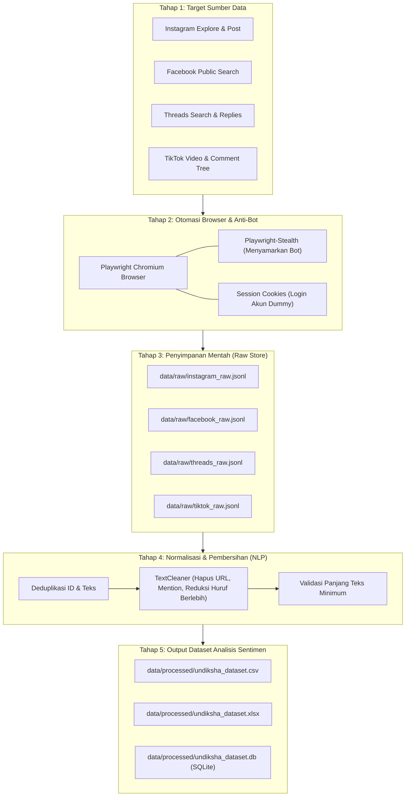
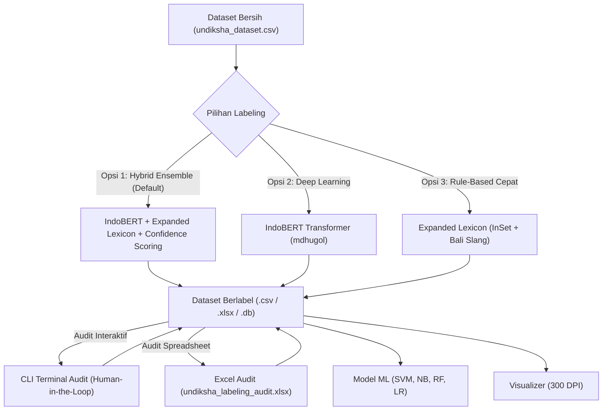

# 📚 Panduan Lengkap & Dokumentasi Pembelajaran Proyek
## Pipeline Pengambilan & Pengolahan Data Media Sosial (#undiksha) untuk Analisis Sentimen

Dokumen ini disusun sebagai panduan belajar komprehensif bagi Anda dalam memahami arsitektur, alur logika program, struktur kode, dan implementasi teknis dari proyek magang ini.

---

## 📑 Daftar Isi
1. [Latar Belakang & Tujuan Proyek](#1-latar-belakang--tujuan-proyek)
2. [Diagram Alur Sistem (Pipeline Architecture)](#2-diagram-alur-sistem-pipeline-architecture)
3. [Struktur Folder & Penjelasan Tiap File](#3-struktur-folder--penjelasan-tiap-file)
4. [Penjelasan Konsep & Teknologi yang Digunakan](#4-penjelasan-konsep--teknologi-yang-digunakan)
5. [Bedah Kode Modul per Modul](#5-bedah-kode-modul-per-modul)
   - [5.1 Skema Data (Pydantic)](#51-skema-data-pydantic)
   - [5.2 Base Scraper & Anti-Bot Stealth](#52-base-scraper--anti-bot-stealth)
   - [5.3 Interactive Session Manager (Cookies)](#53-interactive-session-manager-cookies)
   - [5.4 Scraper Platform (IG, FB, Threads, TikTok)](#54-scraper-platform-spesifik)
   - [5.5 Pembersihan Teks NLP (Cleaner)](#55-pembersihan-teks-nlp-cleaner)
   - [5.6 Penggabungan & Ekspor Dataset (Transformer)](#56-penggabungan--ekspor-dataset-transformer)
   - [5.7 CLI Orchestrator (main.py)](#57-cli-orchestrator-mainpy)
6. [Kamus Data (Data Dictionary)](#6-kamus-data-data-dictionary)
7. [Panduan Operasional & Contoh Perintah](#7-panduan-operasional--contoh-perintah)
8. [Langkah Selanjutnya: Menuju Pemodelan Sentimen](#8-langkah-selanjutnya-menuju-pemodelan-sentimen)

---

## 1. Latar Belakang & Tujuan Proyek

Proyek ini bertujuan untuk membangun sebuah sistem terpadu (*data pipeline*) yang mampu:
1. **Mengambil Data Otomatis (*Automated Retrieval*)**: Mengumpulkan postingan dan komentar masyarakat/mahasiswa bertagar atau terkait `#undiksha` dari 4 media sosial populer: **Instagram, Facebook, Threads, dan TikTok**.
2. **Menangani Tantangan Anti-Scraping**: Melewati pembatasan API resmi Meta/TikTok menggunakan otomatisasi browser (*Playwright*) dengan teknik *stealth* dan manajemen *session cookies*.
3. **Standarisasi Multi-Platform**: Menggabungkan data dari 4 platform yang memiliki struktur berbeda menjadi satu skema data terpadu (*Unified Schema*).
4. **Pra-pemrosesan Teks NLP (*Preprocessing*)**: Membersihkan teks media sosial bahasa Indonesia (menghilangkan link web, mention akun, karakter berulang, dan merapikan spasi) agar langsung siap diolah ke tahap **Analisis Sentimen**.

---

## 2. Diagram Alur Sistem (Pipeline Architecture)

Berikut adalah diagram alur bagaimana data bergerak dari media sosial hingga menjadi file dataset akhir:



---

## 3. Struktur Folder & Penjelasan Tiap File

```
ANALISIS-SENTIMEN/
│
├── config/
│   ├── config.yaml            # File konfigurasi (keyword, limit, delay, opsi pembersihan)
│   └── sessions/              # Menyimpan file cookies (.json) agar tidak sering login
│
├── data/
│   ├── raw/                   # Menyimpan data asli mentah per platform (.jsonl)
│   └── processed/             # Menyimpan dataset bersih final (.csv, .xlsx, .db)
│
├── logs/
│   └── pipeline.log           # Catatan riwayat eksekusi dan error program
│
├── src/
│   ├── models/
│   │   ├── schema.py          # Definisi model data standar Pydantic (SocialMediaItem)
│   │   └── classifier.py      # Pelatihan model ML (TF-IDF + Naive Bayes / Logistic Regression)
│   │
│   ├── scrapers/
│   │   ├── base.py            # Kelas induk scraper (lifecycle browser Playwright, scroll alami)
│   │   ├── session_manager.py # Modul login manual untuk simpan session cookie
│   │   ├── instagram.py       # Logika ekstraksi post & komentar Instagram
│   │   ├── facebook.py        # Logika ekstraksi post & komentar Facebook
│   │   ├── threads.py         # Logika ekstraksi post & balasan Threads
│   │   └── tiktok.py          # Logika ekstraksi video & komentar TikTok
│   │
│   ├── pipeline/
│   │   ├── cleaner.py         # Pembersihan teks (Regex, filter mention, emoji, link)
│   │   ├── transformer.py     # Menggabungkan data mentah, deduplikasi, dan ekspor dataset
│   │   ├── lexicon_data.py    # Basis leksikon kata sentimen, negasi, booster, & emoji
│   │   ├── labeler.py         # Pelabelan semi-otomatis berbasis leksikon Indonesia
│   │   └── visualizer.py      # Generator grafik visualisasi 300 DPI (WordCloud, Pie, Bar, CM)
│   │
│   └── utils/
│       ├── logger.py          # Konfigurasi log terminal berwarna (Rich) & file
│       └── helpers.py         # Fungsi pembantu (delay acak, parsing metrik angka)
│
├── reports/
│   └── figures/               # Hasil gambar grafik visualisasi (300 DPI)
│
├── tests/
│   ├── test_pipeline.py       # Unit test scraping & data transformer
│   └── test_sentiment.py      # Unit test pelabelan, pemodelan ML, dan visualisasi
│
├── main.py                    # Titik masuk utama program (CLI)
├── setup_environment.py       # Script setup otomatis (pip, dependensi, browser)
├── install.bat                # 1-Click installer Windows
├── requirements.txt           # Daftar paket Python yang dibutuhkan
└── README.md                  # Dokumentasi ringkas
```

---

## 4. Penjelasan Konsep & Teknologi yang Digunakan

### Mengapa Playwright (bukan Requests / BeautifulSoup biasa)?
Media sosial masa kini (Instagram, TikTok, Threads, Facebook) dibuat menggunakan framework JavaScript modern (React, Next.js, Vue). Kontennya tidak langsung ada di HTML saat pertama kali diunduh, melainkan dimuat secara dinamis saat halaman di-scroll (*Client-Side Rendering*). **Playwright** mengendalikan browser nyata (Chromium) sehingga JavaScript dieksekusi secara sempurna seperti halnya manusia membuka browser.

### Mengapa Menggunakan `playwright-stealth`?
Platform seperti TikTok dan Meta memiliki sistem pertahanan bot yang mendeteksi properti `navigator.webdriver`. Library stealth menyamarkan sidik jari (*fingerprint*) browser otomasi agar terlihat seperti browser Chrome biasa yang digunakan manusia.

### Mengapa Menggunakan Format JSONL untuk Data Mentah?
*JSON Lines* (JSONL) menulis satu objek JSON per baris. Keunggulannya:
- **Tahan Crash**: Jika koneksi internet terputus di tengah proses scraping, data baris sebelumnya tetap aman tersimpan tanpa membuat file rusak (*corrupted*).
- **Efisiensi Memori**: Kita bisa menulis data satu per satu secara *append* tanpa harus memuat seluruh dataset ke RAM.

### Mengapa Menggunakan Pydantic?
**Pydantic** menjamin integritas tipe data. Jika satu platform mengembalikan metrik likes bertipe teks `"1.2K"`, Pydantic dan fungsi helper memastikan data tersebut dikonversi menjadi integer `1200`, sehingga dataset akhir selalu konsisten.

---

## 5. Bedah Kode Modul per Modul

### 5.1 Skema Data (`src/models/schema.py`)
Mendefinisikan tipe data `SocialMediaItem`. Setiap post dan komentar dari platform mana pun dipaksa memiliki atribut yang sama:
- `id`: ID unik (contoh: `ig_post_123` atau `threads_comment_456`).
- `platform`: Enum (`instagram`, `facebook`, `threads`, `tiktok`).
- `data_type`: `post` atau `comment`.
- `parent_id`: `None` untuk post utama; berisi `id` post utama jika berupa komentar.
- `author`: Nama pengguna atau pembuat konten.
- `content`: Isi teks asli.
- `clean_content`: Teks setelah dibersihkan NLP.
- `engagement`: Objek likes, komentar, shares, views.
- `to_flat_dict()`: Fungsi untuk meratakan (*flatten*) struktur agar langsung kompatibel dengan tabel Pandas DataFrame / CSV.

### 5.2 Base Scraper & Anti-Bot Stealth (`src/scrapers/base.py`)
Kelas dasar (`BaseScraper`) yang diwarisi oleh scraper ke-4 platform:
- `init_browser()`: Membuka Chromium dengan resolusi layar 1280x800, locale Indonesia (`id-ID`), zona waktu WITA (`Asia/Makassar`), dan memuat cookie tersimpan jika ada.
- `human_scroll()`: Menggulir halaman ke bawah secara bertahap dengan jarak bervariasi (*jitter*) dan jeda acak agar menyerupai perilaku manusia.
- `save_item()`: Menulis item yang baru diekstrak langsung ke file `.jsonl` di `data/raw/`.

### 5.3 Interactive Session Manager (`src/scrapers/session_manager.py`)
Fitur unggulan untuk mengatasi *login wall*:
- Menjalankan browser berlayar (*headful*).
- Mengarahkan ke halaman login platform terkait.
- Menunggu pengguna melakukan login secara aman (menggunakan akun dummy).
- Setelah pengguna menekan `ENTER` di terminal, seluruh *state* sesi dan cookies disimpan ke `config/sessions/{platform}_session.json`.

### 5.4 Scraper Platform Spesifik
- **`threads.py`**: Mengakses `threads.net/search?q=%23undiksha`, mengumpulkan URL detail thread, lalu mengekstrak caption pengunggah beserta balasan komentar di bawahnya.
- **`tiktok.py`**: Mengakses `tiktok.com/tag/undiksha`, mengumpulkan link video, membuka panel video untuk mengekstrak deskripsi dan pohon komentar (`comment-list`).
- **`instagram.py`**: Membuka halaman explore tag `#undiksha`, mengumpulkan link `/p/` atau `/reel/`, lalu membaca modal artikel untuk mengambil caption dan komentar.
- **`facebook.py`**: Melakukan pencarian postingan publik Facebook dengan query `undiksha` dan mengekstrak teks postingan beserta komentarnya.

### 5.5 Pembersihan Teks NLP (`src/pipeline/cleaner.py`)
Didesain khusus untuk karakteristik teks media sosial Indonesia:
1. **Penghapusan Tautan**: Menghapus pola `https://...` dan `www....` menggunakan regex.
2. **Penghapusan Mention**: Menghapus `@username` agar tidak mempengaruhi bobot kata sentimen.
3. **Normalisasi Hashtag**: Menghilangkan tanda pagar `#` tetapi mempertahankan kata dasarnya (misal: `#undiksha` menjadi `undiksha`).
4. **Reduksi Karakter Berulang**: Mengubah teks slang yang dipanjangkan (seperti `"bangeeetttt"` menjadi `"banget"`, `"kerennnn"` menjadi `"keren"`).
5. **Normalisasi Spasi & HTML**: Menghilangkan karakter enter berlebih dan menerjemahkan HTML entity (`&amp;` -> `&`).

### 5.6 Penggabungan & Ekspor Dataset (`src/pipeline/transformer.py`)
Mengatur transformasi akhir data:
1. Membaca seluruh file JSONL dari `data/raw/`.
2. Melakukan deduplikasi berdasarkan kombinasi ID unik dan kesamaan teks konten.
3. Menjalankan fungsi pembersih teks (`TextCleaner`) pada setiap baris data.
4. Mengekstrak data ke 3 format sekaligus:
   - **CSV (`.csv`)**: Format standar untuk analisis data dan pelatihan model NLP.
   - **Excel (`.xlsx`)**: Mudah dibuka untuk inspeksi manual oleh dosen pembimbing atau laporan magang.
   - **SQLite (`.db`)**: Database lokal untuk kemudahan querying SQL (`SELECT * FROM sentiment_data WHERE platform='instagram'`).
5. Menampilkan tabel visual ringkasan statistik (jumlah post vs komentar per platform).

### 5.7 CLI Orchestrator (`main.py`)
Menyediakan perintah berbasis terminal yang ramah pengguna dengan bantuan modul `argparse` dan `rich`. Mengatur apakah scraping dilakukan sekaligus atau platform per platform.

---

## 6. Kamus Data (Data Dictionary)

Struktur tabel akhir pada dataset `data/processed/undiksha_dataset.csv`:

| Nama Kolom | Tipe Data | Keterangan | Contoh Nilai |
| :--- | :--- | :--- | :--- |
| `id` | String | Identifier unik data | `ig_post_17892348` |
| `platform` | String | Asal media sosial | `instagram`, `facebook`, `threads`, `tiktok` |
| `data_type` | String | Tipe data | `post` (post utama) atau `comment` (komentar) |
| `parent_id` | String | ID post induk (jika komentar) | `ig_post_17892348` atau `None` |
| `author` | String | Username pengunggah | `bem_undiksha` |
| `content` | String | Teks asli sebelum dibersihkan | `Semangat PKKMB Undiksha 2024! https://bit.ly/undiksha` |
| `clean_content` | String | Teks hasil pembersihan NLP | `Semangat PKKMB Undiksha 2024!` |
| `created_at` | String | Timestamp pembuatan postingan | `2024-09-20T10:15:00` |
| `url` | String | Tautan langsung konten di web | `https://www.instagram.com/p/C_12345/` |
| `likes` | Integer | Jumlah suka / reaksi | `240` |
| `comments_count` | Integer | Jumlah total komentar | `15` |
| `shares` | Integer | Jumlah dibagikan | `5` |
| `views` | Integer | Jumlah penayangan (views) | `1200` |
| `hashtag_query` | String | Kata kunci pencarian | `#undiksha` |
| `scraped_at` | String | Waktu saat data di-scrape | `2026-09-22T00:10:00` |

---

## 7. Panduan Operasional & Contoh Perintah

### A. Login Akun Dummy (Hanya Dilakukan Sekali di Awal)
```bash
# Login Instagram
python main.py --login instagram

# Login Threads
python main.py --login threads

# Login TikTok
python main.py --login tiktok

# Login Facebook
python main.py --login facebook
```
*Tips: Jendela browser akan terbuka. Masukkan akun dummy Anda. Begitu feed terbuka, kembali ke terminal dan tekan tombol [ENTER].*

### B. Menjalankan Scraping
```bash
# 1. Jalankan untuk seluruh 4 platform sekaligus (default 30 post per platform)
python main.py

# 2. Jalankan hanya untuk Threads sebanyak 50 post
python main.py --platform threads --limit 50

# 3. Jalankan hanya untuk TikTok sebanyak 20 post
python main.py --platform tiktok --limit 20

### 8. Multi-Option Sentiment Labeling Suite & Pipeline

Untuk menangani skala dataset yang semakin besar (> 1.000 komentar dan post) serta menjaga standar validitas ilmiah (laporan magang & skripsi), pipeline ini menyediakan **4 Opsi Pelabelan Profesional**:



### Ringkasan Opsi Pelabelan:
1. **Opsi 1: Hybrid Ensemble (`--method hybrid`) [REKOMENDASI UTAMA]**:
   - Menggabungkan model **Deep Learning IndoBERT** dan **Kamus Leksikon yang Diperluas**.
   - Menghitung **skor keyakinan (Confidence Score)** dan menandai potensi ambiguitas (`is_conflict`).
   - Menyelesaikan bias kamus (meningkatkan deteksi sentimen negatif dari 1.4% menjadi 6.4%+ secara akurat).
2. **Opsi 2: IndoBERT Deep Learning Transformer (`--method indobert`)**:
   - Memakai model Transformer terlatih `mdhugol/indonesia-bert-sentiment-classification` berbasis IndoNLU.
   - Sangat unggul dalam memahami tata bahasa informal, sarkasme, negasi ganda, dan konteks semantik.
3. **Opsi 3: Enhanced Lexicon (`--method lexicon`)**:
   - Berbasis aturan leksikon InSet yang diperluas dengan ribuan kata sentimen, slang medsos (*bgt, lelet, ampas, php, scam*), istilah khas Bali/Singaraja (*luung, sing melah, becik, suksma*), serta klausul konjungsi kontras (*tapi, namun, sayangnya*).
   - 100% offline, instan (< 1 detik untuk ribuan baris).
4. **Opsi 4: Human-in-the-Loop CLI Audit (`--audit`) & Excel Workflow (`--export-audit`)**:
   - Menyediakan sarana audit cepat bagi pengguna/mahasiswa untuk meninjau baris-baris ambigu secara interaktif di terminal atau lewat Microsoft Excel.

---

### Panduan Eksekusi Lengkap:

```bash
# ==============================================================================
# 1. PELABELAN DATASET (PILIH METODE SESUAI KEBUTUHAN)
# ==============================================================================

# A. Pelabelan Hybrid Ensemble (Rekomendasi Terbaik untuk Skala Besar)
python main.py --label --method hybrid

# B. Pelabelan Deep Learning Murni (IndoBERT)
python main.py --label --method indobert

# C. Pelabelan Aturan Leksikon Cepat & Offline
python main.py --label --method lexicon

# ==============================================================================
# 2. AUDIT & QUALITY CONTROL (HUMAN-IN-THE-LOOP)
# ==============================================================================

# A. Audit Interaktif Cepat di Terminal (Hanya baris yang berkonflik/ambigu)
python main.py --audit --audit-filter conflicts

# B. Audit Seluruh Data yang Skor Keyakinannya Rendah (< 75%)
python main.py --audit --audit-filter uncertain

# C. Ekspor Data Ambigu ke Berkas Excel untuk Ditinjau Manual / Bersama Pembimbing
python main.py --export-audit
# Output: data/processed/undiksha_labeling_audit.xlsx

# D. Impor Kembali Hasil Koreksi Manual dari Excel ke Dataset Utama
python main.py --import-audit data/processed/undiksha_labeling_audit.xlsx

# ==============================================================================
# 3. PELATIHAN MODEL MACHINE LEARNING
# ==============================================================================
python main.py --train                              # Default: Linear SVM Balanced
python main.py --train --model svm                  # Linear SVM (F1 tertinggi)
python main.py --train --model complement_nb        # Complement Naïve Bayes (Spesialis imbalanced)
python main.py --train --model random_forest        # Random Forest Ensemble
python main.py --train --model logistic_regression  # Logistic Regression
python main.py --train --model naive_bayes          # Multinomial Naïve Bayes

# ==============================================================================
# 4. PEMBUATAN GRAFIK VISUALISASI
# ==============================================================================
python main.py --visualize

# ==============================================================================
# 5. PIPELINE END-TO-END (LABELING + TRAINING + VISUALIZING)
# ==============================================================================
python main.py --analyze --method hybrid --model svm
```

### Output yang Dihasilkan:
1. **Dataset Berlabel**:
   - `data/processed/undiksha_dataset_labeled.csv` (Dilengkapi kolom `confidence`, `is_conflict`, `pos_prob`, `neg_prob`, dll.)
   - `data/processed/undiksha_dataset_labeled.xlsx` (Excel berlabel lengkap)
   - Tabel `labeled_sentiment_data` pada SQLite `data/processed/undiksha_dataset.db`
2. **Berkas Audit Terbimbing**:
   - `data/processed/undiksha_labeling_audit.xlsx` (Berkas khusus baris ambigu siap review)
3. **Model & Feature Extractor**:
   - `data/models/sentiment_model.pkl` (Model klasifikasi terlatih)
   - `data/models/tfidf_vectorizer.pkl` (Vektorisasi TF-IDF n-gram)
4. **Galeri Visualisasi (300 DPI)**:
   - `reports/figures/sentiment_distribution.png` (Donut & Bar Chart)
   - `reports/figures/sentiment_by_platform.png` (Komparasi antar Medsos)
   - `reports/figures/sentiment_wordclouds.png` (WordCloud kata positif & negatif)
   - `reports/figures/confusion_matrix.png` (Heatmap evaluasi performa model)

---
*Dokumentasi ini dirancang agar siap Anda jadikan rujukan materi untuk penyusunan laporan magang dan presentasi tugas akhir.*


